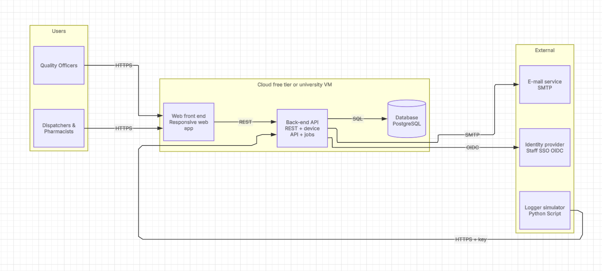
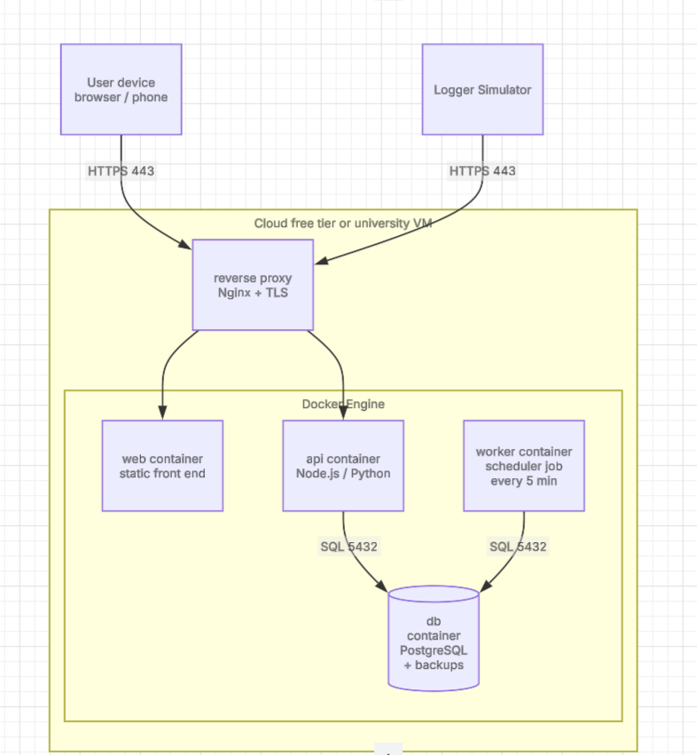
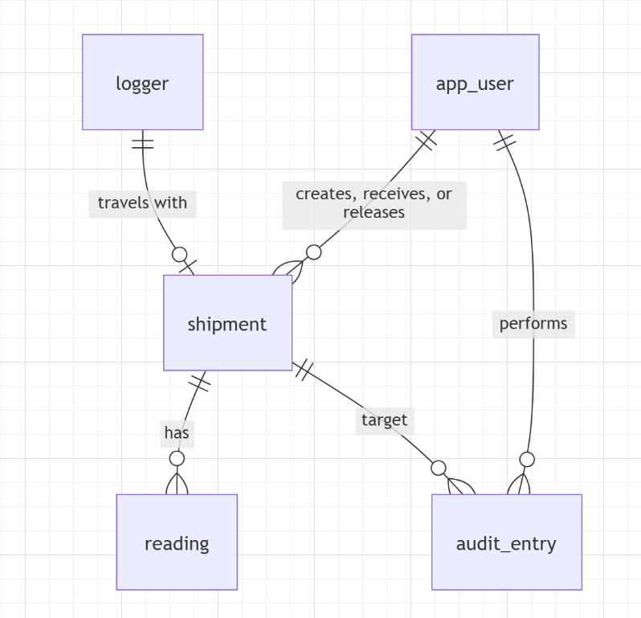
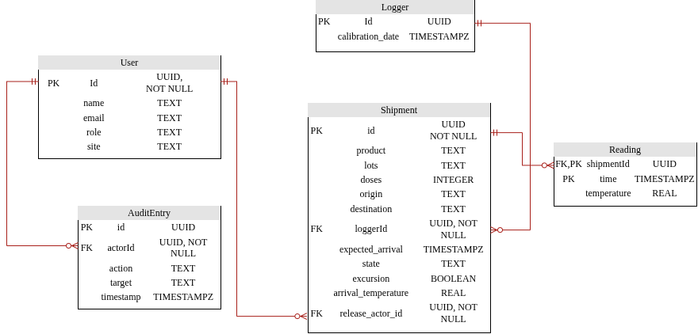
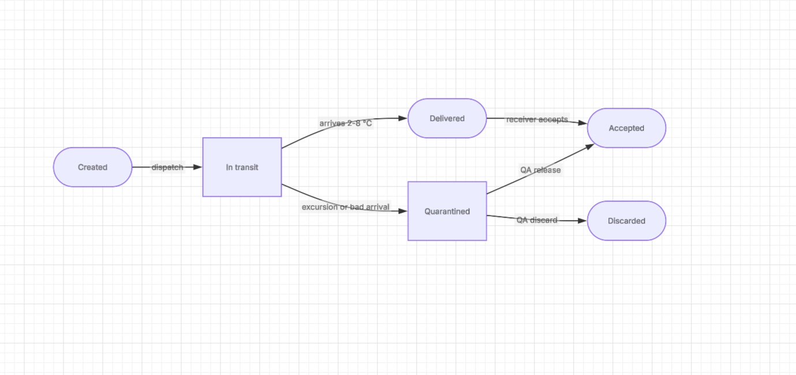
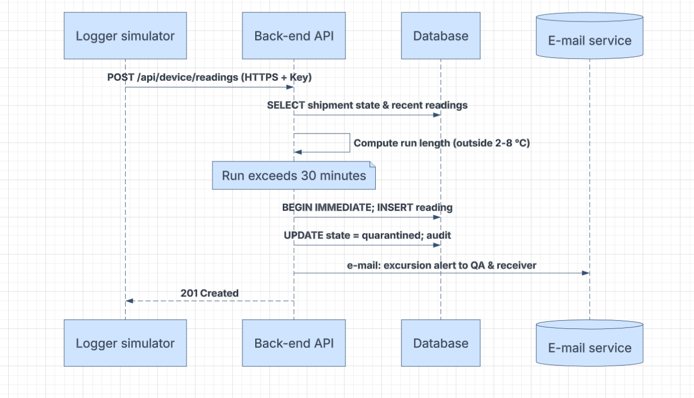
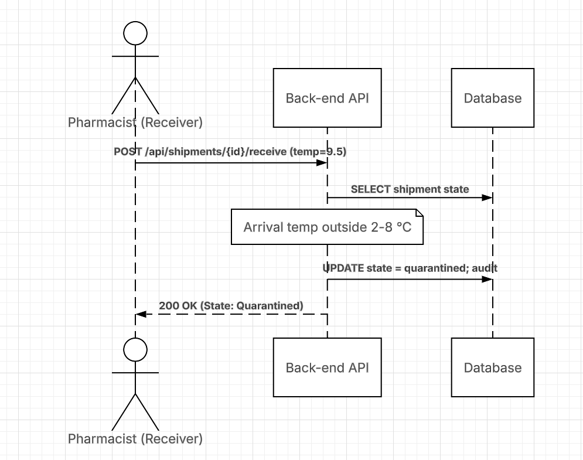
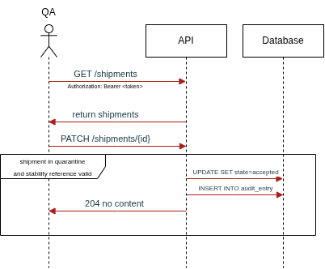

# PMP 5: Architecture and design description, Author: Mohammad

## Architecture views

The following are the high level architectural views of ColdChain:

### Container view:

### Deployment diagram:

## Data design

The following are the refined designs of the data models:

### ERD:

### Database schema:

### Shipment lifecycle:

## Key interactions:

The following are sequence diagrams of the most common use cases:

### Excursion detected from a reading:

### Shipment receipt by a pharmacist:

### Quarantined shipment QA release:

## Architectural decision record

|   Id   	|           Decision           	|                               Baseline choice                               	|                               Reason                               	|  Status  	|
|:------:	|:----------------------------:	|:---------------------------------------------------------------------------:	|:------------------------------------------------------------------:	|:--------:	|
| ADR-01 	|      Architectural style     	|     Layered three-tier, modular monolith backend with a device endpoint     	|            Small team, easy to test, one deployable unit           	| Accepted 	|
| ADR-02 	| Lost-signal and  late alerts 	|                        Scheduled job every 5 minutes                        	|                   Simple, no extra infrastructure                  	| Accepted 	|
| ADR-03 	|         Model id type        	|                            UUID for primary keys                            	|           Enhanced security and decentralized generation           	| Accepted 	|
| ADR-04 	|     Device authentication    	|                    Device key sent in a header over HTTPS                   	|            Isolation, a stolen key doesnt affect others            	| Accepted 	|
| ADR-05 	|      Excursion detection     	| Length of the current run of out-of range readings computed on each reading 	|               Works with late and duplicate readings               	| Accepted 	|
| ADR-06 	|   Audit trail  immutability  	|     Append-only database tables (audit, readings) with restricted writes    	|             Guarantees compliance and tamper-proof logs            	| Accepted 	|
| ADR-07 	|   No unreleased acceptance   	|      State machine in the service, plus a  trigger on the state change      	|            exposed vaccines never enter stock by mistake           	| Accepted 	|
| ADR-08 	|    Business rules location   	|        Dedicated service module for state machine and excursion logic       	| Patient-safety rules can be tested  independently of HTTP routing. 	| Accepted 	|

## API outline

| **Method** 	|           **Path**           	|        **Allowed users**        	|                     **Purpose**                    	|
|:----------:	|:----------------------------:	|:-------------------------------:	|:--------------------------------------------------:	|
|     GET    	|        /api/shipments        	| qa, dispatcher, receiver, admin 	| view the shipments related to the site of the user 	|
|    POST    	|        /api/shipments        	|            dispatcher           	|                  create a shipment                 	|
|    PATCH   	|      /api/shipments/{id}     	|           qa, receiver          	|           alter a property for a shipment          	|
|     GET    	|         /api/loggers         	|          qa, dispatcher         	|                returns all loggers                 	|
|    POST    	|         /api/loggers         	|                qa               	|                 creates new loggers                	|
|    PATCH   	|       /api/loggers/{id}      	|                qa               	|          edit calibration date of a logger         	|
|     GET    	| /api/shipments/{id}/readings 	|           receiver, qa          	|         returns readings of the shipment id        	|
|    POST    	|         /api/readings        	|             loggers             	|                  add a new reading                 	|
|     GET    	|          /api/alerts         	|     qa, dispatcher, receiver    	|             view alerts from shipments             	|
|     GET    	|        /api/audit-logs       	|              admin              	|           view actions performed by users          	|

## Main wireframes

|   Screen   	|                             Purpose                            	|                                            Key elements                                           	|
|:----------:	|:--------------------------------------------------------------:	|:-------------------------------------------------------------------------------------------------:	|
|    Home    	|         The first page users see after opening the site        	|                                 sign in, ColdChain overview, logo                                 	|
|   Alerts   	|              Shows all alerts received by the user             	|                       A list of alerts showing shipment, time, alert reason                       	|
|  Shipments 	|             Shows the shipments related to the user            	|                A list of shipments, shipment creation, shipment details, temperature details and graph               	|
|   Loggers  	|  Shows the loggers registered and allows editing and creation  	|                    A list of logger and their details, create and edit loggers                    	|
| Quarantine 	| Shows all shipments related to the user that are in quarantine 	| A list of quarantined shipments and their details, temperatures, and release or discard shipments 	|
|    Admin dashboard   	|            Views all actions performed in the system           	|                      User list, shipment list, logger list, and actions list                      	|