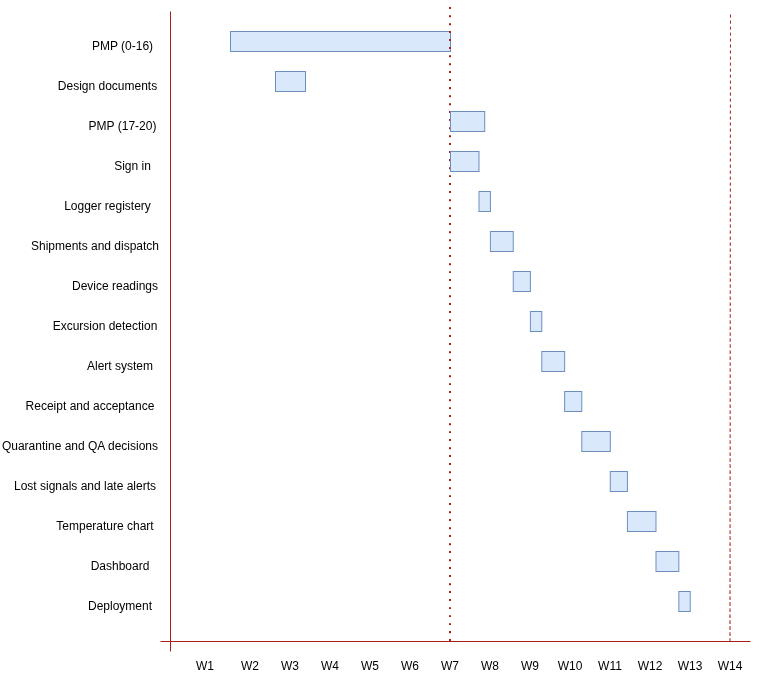

# PMP 6: Schedule management plan, Author: Hamza

## Estimates table

|  WBS ID  	|                  Work package                  	| Estimated Effort (Hours) 	| Target Sprint 	|
|:--------:	|:----------------------------------------------:	|:------------------------:	|:-------------:	|
|  1.1.1.1 	|        Project charter and business case       	|             5            	|     Part 1    	|
|  1.1.1.2 	|        Introduction and project overview       	|             3            	|     Part 1    	|
|  1.1.1.3 	|       Development approach and life cycle      	|             2            	|     Part 1    	|
|  1.1.1.4 	|       Project organization and governance      	|             3            	|     Part 1    	|
|  1.1.1.5 	|     Scope and requirements management plan     	|            16            	|     Part 1    	|
|  1.1.1.6 	|       Architecture and design description      	|             8            	|     Part 1    	|
|  1.1.1.7 	|            Schedule management plan            	|             8            	|     Part 1    	|
|  1.1.1.8 	|              Cost management plan              	|             6            	|     Part 1    	|
|  1.1.1.9 	|            Resource management plan            	|             4            	|     Part 1    	|
| 1.1.1.10 	| Stakeholder engagement and communications plan 	|             4            	|     Part 1    	|
| 1.1.1.11 	|              Risk management plan              	|             3            	|     Part 1    	|
| 1.1.1.12 	|             Quality management plan            	|             4            	|     Part 1    	|
| 1.1.1.13 	|            Security and privacy plan           	|             6            	|     Part 1    	|
| 1.1.1.14 	|            Sourcing and tooling plan           	|             3            	|     Part 1    	|
| 1.1.1.15 	|          Configuration management plan         	|             8            	|     Part 1    	|
| 1.1.1.16 	|                Construction plan               	|            12            	|     Part 1    	|
| 1.1.1.17 	|                    Test plan                   	|             8            	|     Part 1    	|
|   1.1.2  	|                Design documents                	|             8            	|     Part 1    	|
|   1.2.1  	|         Project management plan (17-20)        	|            18            	|    Sprint 1   	|
|  1.2.2.1 	|                     Sign in                    	|            20            	|    Sprint 1   	|
|  1.2.2.2 	|                 Logger registry                	|            12            	|    Sprint 1   	|
|  1.2.2.3 	|             Shipments and dispatch             	|            24            	|    Sprint 1   	|
|  1.2.2.4 	|                 Device readings                	|             4            	|    Sprint 1   	|
|  1.2.3.1 	|               Excursion detection              	|             2            	|    Sprint 2   	|
|  1.2.3.2 	|                  Alert system                  	|             8            	|    Sprint 2   	|
|  1.2.3.3 	|             Receipt and acceptance             	|            10            	|    Sprint 2   	|
|  1.2.3.4 	|           Quarantine and QA decisions          	|             8            	|    Sprint 2   	|
|  1.2.4.1 	|          Lost signals and late alerts          	|             6            	|    Sprint 3   	|
|  1.2.4.2 	|               Temperature charts               	|            16            	|    Sprint 3   	|
|  1.2.4.3 	|                    Dashboard                   	|             8            	|    Sprint 3   	|
|  1.2.4.4 	|                   Deployment                   	|            10            	|    Sprint 3   	|

Total estimated effort is 257 hours. With 3 team members working 8 hours a week for 14 weeks, the team has a total capacity of 336 hours, leaving a buffer of 79 hours for integration, exams, and unexpected results.

## Gantt chart

## Milestones

### Week 2

- Team formed
- Roles agreed
- Working agreement discussed

### Week 4

- Product backlog refined, Requirements reviewed with the TA

### Week 7

- Part 1 checkpoint submission, PMP 0-16 and diagrams submitted

### Week 8,9 (Sprint 1)

- Sign-in
- Logger registry
- Shipments and dispatch
- Device readings

### Week 10,11 (Sprint 2)

- Excursion detection
- Alert system
- Receipt and acceptance
- Quarantine and QA decisions

### Week 12,13 (Sprint 3)

- Lost signal and late alerts
- Temperature charts
- Dashboard
- Deployment

### Week 14

- Part 2 checkpoint, the complete PMP from 0 to 20, working MVP, test evidence and closure report

### Week 15

- Presentation, Discussion, and the Online test

## Critical path

The critical path for ColdChain flows through the core data pipeline: Sign-in $\rightarrow$ Logger registry $\rightarrow$ Shipments and dispatch $\rightarrow$ Device readings $\rightarrow$ Excursion detection $\rightarrow$ Alert system $\rightarrow$ Receipt and acceptance $\rightarrow$ Quarantine and QA decisions $\rightarrow$ Temperature charts $\rightarrow$ Deployment   

Any delay on tasks along this path will delay the MVP completion, and will impact the delivery milestones.