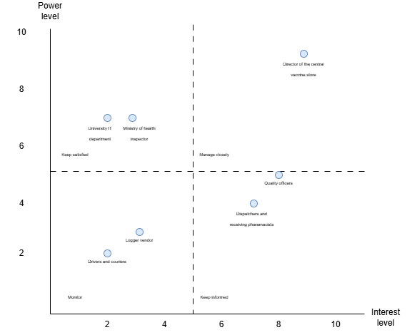

# PMP 9: Stakeholder engagement and communications plan, Author: Anas, Hamza

## Stakeholder register

|                 **Stakeholder**                 |                  **Interest in ColdChain**                  | Power | Interest level |    Strategy    |
|:-----------------------------------------------:|:-----------------------------------------------------------:|:-----:|:--------------:|:--------------:|
| Director of the central vaccine store (sponsor) | No exposed vaccines reach patients; evidence for inspectors |   9   |        9       | Manage closely |
|                 Quality officers                |     Immediate excursion alerts; clear release decisions     |   5   |        8       |  Keep informed |
|                   Dispatchers                   |         Simple shipment creation with logger checks         |   4   |        7       |  Keep informed |
|              Receiving pharmacists              |          Know what is coming and whether it is safe         |   4   |        7       |  Keep informed |
|               Drivers and couriers              |            Clear instructions when alerts happen            |   2   |        2       |     Monitor    |
|           Ministry of Health inspector          |          Complete temperature records per shipment          |   7   |        3       | Keep satisfied |
|                  Logger vendor                  |             Correct use of the device interface             |   3   |        3       |     Monitor    |
|             University IT department            |        Hosting, security and support after hand-over        |   7   |        2       | Keep satisfied |

## Stakeholder chart

## Communications table

|               Communication              |   Audience   |     Channel     |              Frequency             | Owner |
|:----------------------------------------:|:------------:|:---------------:|:----------------------------------:|:-----:|
|               Team meetings              |     Team     | Text or meeting |              Variable              |   PM  |
| Sprint retrospective and sprint planning |     Team     |     Meetings    |          Once every sprint         |   PM  |
|   Project plan and  requirements review  | Sponsor (TA) |    In-person    | Whenever the team needs assistance |   PM  |
|         Milestone progress update        |    Sponsor   |      Email      |          Once every month          |   PM  |